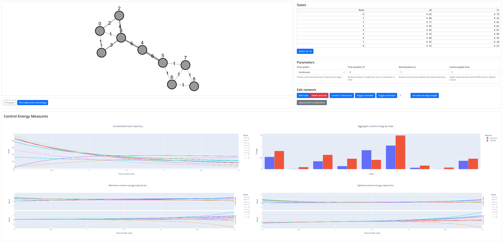

# Network Control Theory tutorial

An interactive Dash application for learning [Network Control Theory](https://github.com/LindenParkesLab/nctpy).



## Features

- Add and remove nodes without renumbering the nodes that remain.
- Pan and zoom with automatic recovery if the graph leaves the canvas; use **Fit graph** to show all nodes without changing their positions.
- Connect selected nodes, remove selected edges, and edit edge weights.
- Select controller and constrained nodes.
- Edit or swap initial and target states.
- Upload a complete `A`, `B`, `S`, `c`, `T`, `x0`, `xf`, and `rho` configuration.
- Inspect density, degree, strength, and clustering as the topology changes.
- Plot uncontrolled trajectories, minimum/optimal control inputs, and aggregate energy per node.

## Run locally

```bash
conda env create -f environment.yml
conda activate nct-tutorial
python app.py
```

Open <http://localhost:8050>.

## Run with Docker

```bash
docker build -t nct-tutorial .
docker run --rm -p 8050:8050 nct-tutorial
```

Open <http://localhost:8050>. The container uses Miniconda and serves the app with Gunicorn.

## Upload format

Use a UTF-8 JSON file. `A` is required. `B` and `S` are optional diagonal matrices and default to identity matrices. `x0` and `xf` are optional vectors and default to zero. `c`, `T`, and `rho` are optional and default to `1`, `3`, and `1` respectively.

```json
{
  "A": [[0, 1], [1, 0]],
  "B": [[1, 0], [0, 1]],
  "S": [[1, 0], [0, 1]],
  "c": 1,
  "T": 3,
  "x0": [1, 0],
  "xf": [0, 1],
  "rho": 1
}
```

See [`example-config.json`](example-config.json) for a ready-to-upload example.

## Code organization

| Module | Responsibility |
| --- | --- |
| `nct_utils.py` | Numerical model: nctpy normalization/control solutions, bct topology metrics, and energy aggregation. Accepts arrays and returns numerical results. |
| `graph_utils.py` | Cytoscape editing, upload validation, UI state, and conversion between graph elements and model arrays. |
| `view_utils.py` | Cytoscape styles, persistent parameter labels, topology cards, and Plotly figures. Consumes precomputed metrics and energies. |
| `app.py` | Dash layout and controller callbacks that coordinate the helpers. |

Graph helpers previously imported from `nct_utils` now live in `graph_utils`.
Each helper documents its input format, return values, and relevant conventions.

## Numerical conventions

All trajectories use discrete dynamics, `x(t+1) = A_normalized x(t) + B u(t)`.
`c` is passed explicitly to nctpy's discrete normalization. `T` is the number
of transitions: plots contain `T+1` states and `T` control inputs. `rho`
weights control-input cost in the optimal solution; minimum-energy control
uses a zero state-constraint matrix. Energy per node is the sum of squared
inputs across the `T` steps.

This replaces the earlier combination of discrete state simulation and a
continuous control solver. nctpy handles `T >= 2`; the one-step case is solved
directly from `B u = xf - A_normalized x0`, with unreachable targets reported
as input errors. Both control solutions retain the solver's numerical residuals.

Topology cards use bct's undirected density, degree, and binary clustering.
Mean strength uses absolute edge weights. Self-loops are excluded from these
summaries, and empty/single-node networks return zero connectivity measures.

## Test

After installing the app requirements, run the model, graph-adapter, view,
and callback tests with the standard-library test runner:

```bash
python -m unittest discover -s tests -v
```

Viewport logic tests use the real Cytoscape.js engine in headless mode (Node.js required):

```bash
npm install --no-save --package-lock=false cytoscape@3.33.1
node --test tests/test_viewport.cjs
```

Browser regression tests cover viewport recovery, zoom limits, resizing, uploads,
and the **Fit graph** button. Install the app requirements first, then run:

```bash
python -m pip install playwright
python -m playwright install chromium
python -m unittest discover -s tests/browser -v
```
