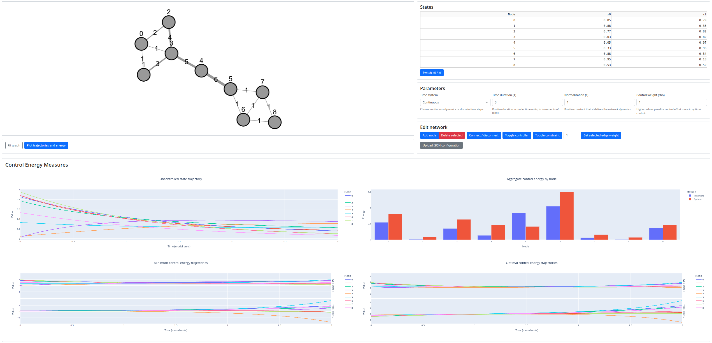

# Network Control Theory tutorial

An interactive Dash application for learning [Network Control Theory](https://github.com/LindenParkesLab/nctpy).



## Features

- Add and remove nodes from the adjacency matrix
- Connect selected nodes, remove selected edges, and edit edge weights.
- Select controller and state-penalty nodes.
- Edit or swap initial and target states.
- Upload a complete `A`, `B`, `S`, `c`, `T`, `x0`, `xf`, `rho`, and `system` configuration.
- Inspect density, degree, strength, and clustering as the topology changes.
- Compare minimum-energy trajectories and optimal-control trajectories for the selected time system.
- Inspect uncontrolled trajectories and aggregate energy per node for the selected time system.

## Run locally

```bash
conda env create -f environment.yml
conda activate nct-tutorial
python -m src.app
```

Run these commands from the repository root, then open <http://localhost:8050>.
For Gunicorn, use `gunicorn --bind 0.0.0.0:8050 src.app:server`.

## Run with Docker

```bash
docker build -t nct-tutorial .
docker run --rm -p 8050:8050 nct-tutorial
```

Open <http://localhost:8050>. The container uses Miniconda and serves the app with Gunicorn.

## Upload format

Use a UTF-8 JSON file. `A` is required. `B` and `S` are optional diagonal matrices and default to identity matrices. `x0` and `xf` are optional vectors and default to zero. `c` and `rho` default to `1`. If omitted, `T` defaults to `1` for continuous time and `3` for discrete time; an explicitly supplied `T` is preserved.

`system` is optional and accepts `"discrete"` or `"continuous"`.
Discrete `T` must be a positive integer; continuous `T` is a positive duration
in increments of `0.001`, for example `0.5` or `1.25`. Older JSON files without
`system` continue to use discrete time for compatibility, even though new app
sessions start in continuous time. Uploading a configuration also updates
the time-system selector and the horizon label.

```json
{
  "A": [[0, 1], [1, 0]],
  "B": [[1, 0], [0, 1]],
  "S": [[1, 0], [0, 1]],
  "c": 1,
  "T": 3,
  "x0": [1, 0],
  "xf": [0, 1],
  "rho": 1,
  "system": "discrete"
}
```

See [`example-config.json`](example-config.json) for a ready-to-upload example.
